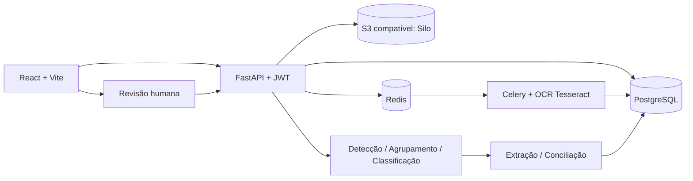

# Concilia AI — MVP Essencial

**Hack Garanhuns Tech 2026 · Desafio 3 — Document AI Factory**

> **Apoio à conferência. Não substitui análise jurídica ou tributária.**
> MVP experimental com classificadores e regras heurísticas. Trabalhe somente com documentos sintéticos ou autorizados.

## Entregas deste pacote

Esta é a **Fase 3 + implementação simplificada das Fases 4–7**. Mantém o código anterior e adiciona:

| Requisito | Implementação no MVP | Limitação |
|---|---|---|
| Upload de PDF, PNG, JPG, TIFF | API e interface já existentes | 40 MB e 500 páginas por arquivo; sem ZIP/XML no upload |
| OCR pesquisável | Tesseract `por+eng` + extração direta de PDF; consulta textual `/search` | Não gera PDF pesquisável derivado; busca simples, sem índice FTS |
| Detecção de início/fim | Heurísticas: `Página X de Y`, identificadores e mudança de tipo | Pode falhar em documentos sem marcadores ou com OCR ruim |
| Agrupamento de páginas | Grupos persistidos por arquivo de origem | Páginas devem ser consecutivas no arquivo; não reordena páginas |
| Classificação por tipo | Contrato, nota fiscal, aditivo, outros | Regras, sem modelo treinado |
| Confiança | Score heurístico associado ao OCR e classificação | **Não é probabilidade calibrada** |
| Revisão humana | Fila por confiança, corrigir tipo, dividir, juntar, aprovar, registrar justificativa | Interface textual, sem comparação lado a lado de imagens |
| Conciliação por evidência | Valores, vigência, serviço e nota duplicada; procura aditivo aplicável | Extratores adaptados aos formulários **sintéticos**; não cobre toda NFS-e/contratos reais |

A conciliação sinaliza discrepâncias; **não determina ilegalidade ou erro tributário**. A existência de aditivo só justifica diferença se contrato, valor e vigência forem compatíveis. Casos classificados como justificados ainda exigem validação humana.

## Instalar no Windows CMD

Requisitos: Docker Desktop aberto, WSL 2 e acesso à internet para a primeira compilação.

1. **Atualize sua cópia sem perder o `.env` e os dados persistidos.** Extraia o ZIP em uma **nova pasta**, por exemplo `C:\Users\Leonardo\Downloads\Concilia_AI_MVP_Essencial\concilia-ai`.
2. Copie seu arquivo `.env` da Fase 3 para essa nova pasta. Se ainda não tiver um `.env`, use `copy .env.example .env` e configure suas senhas.
3. Abra o CMD na pasta nova e execute:

```cmd
cd C:\Users\Leonardo\Downloads\Concilia_AI_MVP_Essencial\concilia-ai
docker compose up --build -d
docker compose ps
```

4. Abra **http://localhost:5173**. Entre com o login e a senha configurados no `.env` (`admin` ou `revisor` para operações de revisão).
5. API em **http://localhost:8000/docs**; endpoint `GET /health` retorna `"phase": "mvp-essential"`.

**Atenção:** se você já está executando a Fase 3 em outra pasta com as mesmas portas, pare **somente os containers da Fase 3** com `docker compose down` antes de subir o novo projeto. **Não execute `down -v`**, porque remove volumes. Se mudar a pasta/projeto Compose, poderá haver novos volumes e os lotes antigos não aparecerão automaticamente. Para reutilizar dados, atualize os arquivos no repositório atual em vez de criar projeto Compose separado, faça backup do banco e confirme o plano de migração. O banco recebe a migração `0003_mvp_essential` automaticamente pelo serviço `api`.

## Demonstração rápida

O pacote contém uma amostra real de teste, `demo/lote_demo_essencial.pdf`, com **14 páginas / 7 documentos** sintéticos.

1. Abra **Concilia AI**, faça login como `admin`.
2. Clique **Novo lote**.
3. Envie `demo/lote_demo_essencial.pdf`.
4. Clique **1. Iniciar OCR**. Acompanhe o progresso até 100%.
5. Clique **2. Separar e conciliar**.
6. Consulte as abas **Documentos**, **Revisão**, **Conciliação**, **Busca OCR** e **Páginas OCR**.
7. Em **Busca OCR**, pesquise `30000` ou `CTR-001`. Na aba Documentos, teste corrigir/aprovar com justificativa.

**Gabarito da amostra:** `demo/gabarito_demo.json`. O documento contém três notas com cobranças acima de três contratos: uma diferença de R$ 2.500 documentada por aditivo vigente, duas sem justificativa aplicável. A análise real feita nesta entrega identificou 7 grupos e gerou 3 alertas (1 justificado sujeito à revisão e 2 divergências). Resultados em `demo/resultado_verificacao_local.json`.

**Para testar o lote de 304 páginas**, execute o gerador da Fase 2:

```cmd
docker compose --profile tools run --build --rm generator
```

O PDF fica em `data\synthetic\lotes\lote_misturado.pdf`. O processamento completo de 304 páginas não foi validado neste ambiente; avalie o desempenho no seu Docker.

## Arquitetura



O MVP **não depende de LLM** e roda localmente após baixar as imagens/dependências. A integração com modelos multimodais e XML fiscal oficial permanece fora do escopo.

## API adicional

| Método | Endpoint | Uso |
|---|---|---|
| POST | `/batches/{id}/analyze` | Após OCR completo, segmenta, classifica, extrai e concilia |
| GET | `/batches/{id}/documents` | Grupos, campos, confiança e evidências |
| GET | `/batches/{id}/findings` | Divergências encontradas |
| GET | `/batches/{id}/search?q=texto` | Busca por texto do OCR e página |
| PATCH | `/documents/{id}/review` | Corrige tipo/aprova, com justificativa (revisor/admin) |
| POST | `/documents/{id}/split` | Divide grupo na página indicada (revisor/admin) |
| POST | `/documents/{id}/merge` | Junta ao grupo imediatamente seguinte (revisor/admin) |
| POST | `/findings/{id}/resolve` | Aceita ou rejeita alerta com justificativa |

**Importante:** análises existentes não são recriadas automaticamente. Isso evita apagar decisões humanas. Criar outro lote é o caminho mais simples para repetir uma demonstração do início. Na interface atual, ações de revisão são acessíveis somente aos perfis `revisor` e `admin`.

## Testes e verificação

### Executar na máquina com Docker

```cmd
docker compose exec api pytest -q
docker compose exec api ruff check .
docker compose ps
docker compose logs --tail=80 api worker
```

O arquivo `backend/tests/conftest.py` já foi atualizado para criar o banco SQLite de testes em `/tmp/test_concilia.db`, corrigindo o problema de permissão encontrado na Fase 3.

### Testes efetivamente executados na produção deste pacote

- **5 testes do motor puro passaram**, cobrindo segmentação, extração, aditivo aplicável, divergência fora da vigência e ausência de contrato.
- **14 páginas sintéticas processadas localmente** com PyMuPDF/Tesseract; 7 agrupamentos encontrados, compatíveis com o gabarito da amostra.
- **3 resultados de conciliação** obtidos: 1 caso `R02_ADITIVO`, 2 casos `R02_VALOR`.
- **Teste de persistência com SQLAlchemy/SQLite passou:** 7 grupos e 3 alertas persistidos; uma segunda análise do mesmo lote foi corretamente bloqueada.
- Compilação de módulos Python executada com sucesso.

**Não executado aqui:** Docker Compose, ciclo HTTP completo, build Vite, migração Alembic em PostgreSQL, testes da API dependentes de Celery/pwdlib. Valide no seu Windows antes da apresentação. O algoritmo é demonstrável com dados sintéticos e **não tem acurácia comprovada em documentos fiscais reais**.

## Limites e premissas

- A segmentação usa principalmente paginação textual, identificadores e mudança de tipo. Documentos com cabeçalhos semelhantes, páginas sem texto ou arquivos embaralhados internamente exigem revisão manual.
- Os extratores são regras que reconhecem os rótulos existentes nos PDFs sintéticos da Fase 2. **Não** interpretam todos os formatos comerciais nem XML oficial de NFS-e.
- A comparação de valor usa **mensalidade contratada vs valor de uma nota**: é premissa demonstrativa, não se aplica automaticamente a preço unitário, medição, reajuste ou faturamento acumulado.
- Na revisão, a classificação alterada é reextraída e os alertas são recalculados, desde que não existam decisões de alertas já concluídas; a reanálise integral não apaga registros humanos.
- A busca OCR é textual, limitada a 100 resultados por consulta. Não produz PDF pesquisável com camada de texto.
- As notas fiscais simuladas **não têm validade fiscal**. Não usar dados pessoais reais, não publicar `.env` ou credenciais e não disponibilizar portas locais na internet.
- Score alto não garante documento correto; a revisão humana é necessária sempre que a informação fundamentar decisão relevante.

## Problemas comuns

- `Docker engine not running`: abrir Docker Desktop/WSL2 e confirmar `docker info`.
- `pull access denied minio/minio`: confirmar no `compose.yaml` a imagem `pgsty/silo` usada no MVP.
- Erro no npm: o `frontend/package.json` usa `overrides` para `electron-to-chromium`; reconstruir frontend com `docker compose build --no-cache frontend` se necessário.
- `readonly database` nos testes: esta versão grava SQLite em `/tmp` dentro do container.
- API em erro: `docker compose logs --tail=100 api` e conferir a migração `0003`.
- Worker parado: `docker compose logs --tail=100 worker`.
- Botão **Separar e conciliar** desabilitado: o OCR deve terminar sem erro em todas as páginas. Consulte `Páginas OCR` e o progresso.
- Novo upload em lote já analisado: crie um novo lote para repetir a análise; preservar agrupamentos prévios evita perda de auditoria.

## GitHub da equipe

Repositório: https://github.com/Noronhanr/ConciliaAI

Antes de substituir arquivos de colegas, sincronize as alterações da equipe. Para publicar o MVP com segurança, crie uma branch, registre os arquivos e abra Pull Request. Se a equipe já autorizou atualizar diretamente a `main`, confirme o estado com `git status`, `git fetch origin`, `git diff` e use push normal — **não use `--force`**.

## Roadmap posterior

Ficam para evolução: parser de XML NFS-e oficial (leiaute verificado), PDFs derivados pesquisáveis, modelos treinados, indicadores com validação de acurácia, escalabilidade real, gestão de filas de falhas, anonimização, controle de acesso empresarial e revisão visual página a página.

**Licença:** a definir pela equipe.
