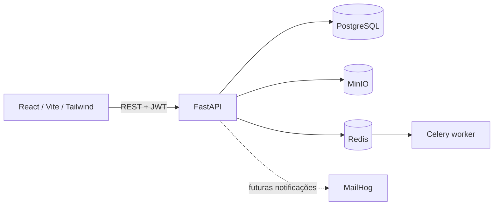

# Concilia AI — Fases 1 e 2

Protótipo para o **Hack Garanhuns Tech 2026 — Desafio 3: Document AI Factory**.
Recebe a base arquitetural de uma plataforma de separação e classificação documental e conciliação contratual, mas **até a Fase 2 a infraestrutura e o gerador local de dados sintéticos estão implementados**. A ingestão, OCR e conciliação ainda não estão disponíveis.

> **Apoio à conferência. Não substitui análise jurídica ou tributária.**

## Como executar

Requisitos: Docker + Docker Compose. Os serviços são executados localmente.

```bash
cp .env.example .env
# Edite as senhas e JWT_SECRET no .env antes de iniciar.
docker compose up --build
```

Abra http://localhost:5173 (frontend), http://localhost:8000/docs (API), http://localhost:9001 (MinIO), http://localhost:8025 (MailHog).
Login: `operador`, `revisor` ou `admin`, usando senhas configuradas no `.env`.

**Segurança:** `.env.example` contém valores apenas de desenvolvimento; altere todas as senhas. Não exponha essas portas à internet. Não envie documentos reais nesta versão. JWT e RBAC de demonstração não substituem gestão corporativa de identidades. Não há TLS, gestão de segredos ou trilhas avançadas de auditoria.

## Arquitetura



## Capacidades por fase

| Capacidade | Estado |
|---|---|
| API REST e OpenAPI | Implementado |
| Login JWT com três perfis | Implementado — demonstração |
| Criação e listagem de lotes | Implementado |
| Banco e migração inicial | Implementado |
| MinIO e fila Celery | Infraestrutura configurada |
| Gerador sintético e gabarito | Implementado — Fase 2 |
| Front responsivo mínimo | Implementado |
| Detecção de início/fim e agrupamento | Pendente — Fase 4 |
| OCR pesquisável | Pendente — Fases 3 e 5 |
| Classificação e confiança | Pendente — Fase 5 |
| Revisão humana | Pendente — Fase 5 |
| Conciliação por evidências | Pendente — Fases 6–7 |
| Recuperação e anonimização | Pendente — Fase 9 |

## Testes

```bash
docker compose exec api pytest -q
docker compose exec api ruff check .
```

### Teste de aceite manual

1. Iniciar serviços e abrir `/health` (retorno `status: ok`, `phase: 1`).
2. Entrar no frontend com credenciais do `.env`.
3. Criar um lote e verificar que ele aparece com status `created`.
4. Confirmar que sem autenticação `GET /batches` retorna HTTP 401.
5. Abrir `/docs` e verificar os endpoints de autenticação e lotes.

## Estrutura

- `backend/app/`: API, modelos, autenticação, armazenamento, Celery e seed.
- `backend/alembic/`: migrações.
- `backend/tests/`: testes de integração HTTP em SQLite isolado.
- `frontend/`: React/Vite/Tailwind.
- `docs/decisoes.md`: decisões e premissas.
- `.github/workflows/ci.yml`: lint, testes, build.

## Contexto, premissas e limitações

A referência à Resolução CGSN nº 191/2026 e ao Emissor Nacional de NFS-e integra a proposta do produto, **não constitui conclusão jurídica validada nesta fase**. O parser de XML do padrão nacional será implementado posteriormente com mapeamento configurável, sujeito à verificação do leiaute oficial. Não existe integração automática com bases fiscais nem acesso indiscriminado a notas de fornecedores.

A operação é offline quanto a modelos de IA. Imagens de containers e dependências exigem acesso à internet na primeira instalação. Não há ainda resultados de avaliação; métricas reais serão apresentadas somente após implementar `evaluate.py`. Dados sintéticos com gabarito são entregues na Fase 2. LGPD: não usar dados pessoais reais; não há anonimização nesta fase.

## Roadmap e demo

Fases 2–8: geração de dados, ingestão/OCR, segmentação, classificação, extração, conciliação e relatórios. Fase 9: retomada de falhas, anonimização e multimodal. Fase 10: documentação e entrega final. A demo da Fase 1 demonstra autenticação e lotes, **não** processamento documental.

Licença: a definir antes da publicação pública do repositório.


## Fase 2 — Gerador sintético e ground truth

A Fase 2 **não executa OCR nem conciliação**. Ela gera arquivos e um gabarito para avaliação nas próximas fases, independentemente do login da aplicação.

### Executar no Windows CMD, sem Python local

Abra o Docker Desktop, entre na pasta `concilia-ai` e execute:

```cmd
docker compose --profile tools run --build --rm generator
```

Os arquivos são gravados na pasta `data\synthetic` do próprio Windows, incluindo:

- `lotes/lote_misturado.pdf`: 304 páginas, 82 documentos PDF (padrão de 20 fornecedores e 3 notas/fornecedor).
- `contratos/`: 20 contratos com 9 páginas; `aditivos/`: 2 aditivos com 2 páginas.
- `notas_pdf/`: 60 NFS-e **didáticas**, cada uma com 2 páginas.
- `notas_xml/`: 60 arquivos XML **didáticos, não oficiais**.
- `ground_truth.json`: tipo de cada documento, mapeamento de todas as páginas, limites, fornecedor, campos esperados e divergências plantadas.
- `summary.json`: totais gerados.

Para abrir o lote no Windows:

```cmd
start data\synthetic\lotes\lote_misturado.pdf
notepad data\synthetic\summary.json
```

**Comando de teste de aceite (Windows CMD):**

```cmd
docker compose --profile tools run --build --rm generator pytest -q scripts/tests/test_generator.py
```

**Gerar lote menor sem imagens digitalizadas (mais rápido):**

```cmd
docker compose --profile tools run --rm generator python scripts/generate_synthetic_batch.py --output /project/data/amostra --suppliers 3 --invoices-per-supplier 3 --no-scan
```

**Atenção:** o gerador apaga e substitui **somente** pastas de saída previamente criadas por ele e marcadas com `.concilia_synthetic`. Nunca direcione `--output` para uma pasta com arquivos pessoais.

### Cenários simulados

- Fornecedor 001: diferença de R$ 2.500 respaldada por aditivo vigente (cenário justificado).
- Fornecedor 002: diferença de R$ 2.500, mas aditivo fora do período.
- Fornecedor 003: valor maior sem justificativa.
- Fornecedor 004: serviço divergente do contrato.
- Fornecedor 005: nota emitida depois do fim da vigência.
- Fornecedor 006: número de nota duplicado.
- Fornecedor 007: nota emitida por CNPJ sem contrato correspondente na base sintética (e sem referência contratual).

**Premissas essenciais:** CNPJs têm dígitos verificadores válidos, porém sua não atribuição real não foi verificada; todas as pessoas jurídicas e condições são fictícias. Os XMLs têm um esquema **criado exclusivamente para teste**, não equivalem ao leiaute nacional da NFS-e. A mistura preserva a ordem das páginas de cada documento e não inclui separadores em branco nesta versão. Os PDFs digitalizados foram rasterizados com ruído/rotação leve, para testes de OCR.

### Avaliação

**Executado neste ambiente:** `pytest -q scripts/tests/test_generator.py` — 4 testes aprovados. Geração integral local do lote de 304 páginas — realizada, com 82 PDFs e 60 XMLs.

**Não executado aqui:** inicialização Docker Compose, funcionamento conjunto dos sete serviços, geração via Docker em Windows. Para isso, execute os comandos de teste acima no computador.


## Fase 3 — Upload, fila e OCR

A Fase 3 adiciona o envio de PDF, PNG, JPEG e TIFF, armazenamento de originais, fila de
processamento Celery por página, OCR Tesseract `por+eng` e painel de progresso.
Para iniciar: `docker compose up --build -d`; abrir `http://localhost:5173`.
Para testar: `docker compose exec api pytest -q`.
Os detalhes e limites estão em [`docs/fase3.md`](docs/fase3.md).

**ATENÇÃO:** a Fase 3 ainda não detecta limites entre documentos nem separa
documentos misturados; isso faz parte da Fase 4. O OCR fica armazenado por página,
sem PDF derivado pesquisável nesta fase.

### Instalação no Windows (CMD)

1. Extraia este ZIP em `C:\Users\Leonardo\Downloads\Concilia_AI_Fase_3`.
2. `cd C:\Users\Leonardo\Downloads\Concilia_AI_Fase_3\concilia-ai`
3. Se usava credenciais personalizadas na Fase 2, copie seu `.env` anterior para esta pasta. Caso contrário: `copy .env.example .env`.
4. `docker compose up --build -d`
5. `docker compose ps` e abra `http://localhost:5173`.
6. `docker compose exec api pytest -q` para executar os testes no container.

**Não execute `docker compose down -v`**, pois isso apaga volumes de dados.
