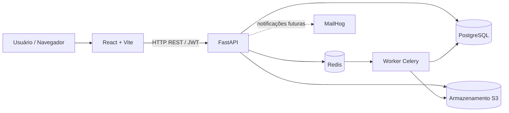

# Concilia AI

**Plataforma de inteligência documental e conciliação contratual**  
**Hack Garanhuns Tech 2026 · Desafio 3 — Document AI Factory**

> **Estado do projeto: Fase 3 (MVP em desenvolvimento).** A aplicação já oferece autenticação, lotes, upload de PDFs e imagens, processamento assíncrono por página e extração de texto com OCR. A segmentação automática, a classificação documental e a conciliação contratual ainda não estão implementadas.
>
> **Aviso:** ferramenta de apoio à conferência documental. Não substitui análise jurídica, contábil ou tributária.

## Sumário

1. [Visão geral](#visão-geral)
2. [O que funciona hoje](#o-que-funciona-hoje)
3. [Tecnologias e arquitetura](#tecnologias-e-arquitetura)
4. [Requisitos](#requisitos)
5. [Instalação rápida no Windows](#instalação-rápida-no-windows)
6. [Configuração do ambiente](#configuração-do-ambiente)
7. [Como utilizar a aplicação](#como-utilizar-a-aplicação)
8. [Geração de documentos sintéticos](#geração-de-documentos-sintéticos)
9. [API e endpoints](#api-e-endpoints)
10. [Testes e validação](#testes-e-validação)
11. [Comandos úteis do Docker](#comandos-úteis-do-docker)
12. [Solução de problemas](#solução-de-problemas)
13. [Desenvolvimento em equipe](#desenvolvimento-em-equipe)
14. [Segurança, limitações e roadmap](#segurança-limitações-e-roadmap)

## Visão geral

O Concilia AI foi concebido para receber documentos empresariais desorganizados — contratos, aditivos, notas fiscais e anexos — e, em fases futuras, separá-los, classificá-los, extrair seus dados e identificar **inconsistências documentais com evidências rastreáveis**.

A solução se divide em duas frentes:

- **Document AI Factory (núcleo do desafio):** ingestão, identificação de páginas, OCR, futura detecção de fronteiras, agrupamento, classificação, confiança e revisão humana.
- **Conciliação contratual (diferencial proposto):** futura comparação entre documentos fiscais, contratos e aditivos, com alertas fundamentados e validação humana.

O sistema não deve afirmar automaticamente que uma cobrança é ilegal ou indevida. A finalidade é **sinalizar diferenças e mostrar sua origem documental**.

## O que funciona hoje

| Funcionalidade | Estado |
|---|---|
| API REST FastAPI e documentação OpenAPI | Implementado |
| Login JWT e perfis `admin`, `revisor` e `operador` | Implementado para demonstração |
| Criação e listagem de lotes | Implementado |
| Upload de PDF, PNG, JPG/JPEG e TIFF | Implementado |
| Armazenamento dos arquivos originais em serviço compatível com S3 | Implementado |
| Processamento assíncrono por página com Celery e Redis | Implementado |
| Extração de texto de PDF digital e OCR de imagem com Tesseract | Implementado |
| Status, progresso, confiança e texto por página | Implementado |
| Gerador de documentos fictícios com gabarito (`ground_truth.json`) | Implementado — Fase 2 |
| Detecção de início/fim e agrupamento de documentos | **Pendente — Fase 4** |
| Classificação, revisão humana e busca no OCR | **Pendente — Fase 5** |
| Extração estruturada e vínculo com contrato | **Pendente — Fase 6** |
| Motor de conciliação e notificações | **Pendente — Fase 7** |
| Relatórios e indicadores de avaliação | **Pendente — Fase 8** |

**Limites atuais do upload:** até **40 MB por arquivo** e **500 páginas por arquivo**. **XML e ZIP ainda não são aceitos no upload**, embora a Fase 2 gere XMLs didáticos para testes futuros. A Fase 3 **não produz PDF derivado pesquisável**: armazena o texto de cada página no banco de dados.

## Tecnologias e arquitetura

- **Frontend:** React, Vite e Tailwind CSS.
- **Backend:** Python 3.11, FastAPI, Pydantic, SQLAlchemy e Alembic.
- **Processamento:** Celery, Redis, PyMuPDF e Tesseract (`por` + `eng`).
- **Persistência:** PostgreSQL e armazenamento S3-compatível (Silo/MinIO).
- **Ferramentas locais:** Docker Compose, MailHog, pytest e GitHub Actions.



Os serviços são executados em containers. O nome `minio` é utilizado no Docker Compose como nome do serviço S3-compatível; a imagem do projeto é `pgsty/silo:RELEASE.2026-09-16T00-00-00Z`.

## Requisitos

- Windows 10/11 com **Docker Desktop** e **WSL 2**, ou Linux/macOS com Docker Compose.
- **Git** para clonar e colaborar.
- Internet para baixar imagens e dependências na primeira execução.
- Memória disponível suficiente para múltiplos containers e processamento OCR.

**Não é necessário instalar Python, PostgreSQL, Redis ou Node.js manualmente** para executar o projeto por Docker.

## Instalação rápida no Windows

Abra o **Docker Desktop** e confira se o motor Linux está ativo. No **CMD** ou terminal do VS Code, execute:

```cmd
git clone https://github.com/Noronhanr/ConciliaAI.git
cd ConciliaAI
copy .env.example .env
notepad .env
```

> Se o repositório da equipe estiver em outra branch, selecione a branch que contém `compose.yaml`, `backend/` e `frontend/`. Se você já clonou o projeto, não precisa cloná-lo novamente.

No `.env`, altere as senhas e chaves de desenvolvimento, conforme explicado na seção seguinte. Salve e então execute:

```cmd
docker compose up --build -d
docker compose ps
```

O primeiro comando constrói e inicia os serviços; o segundo mostra o status dos containers. Confira especialmente `api`, `frontend`, `worker`, `postgres`, `redis` e `minio`.

**Endereços locais:**

| Serviço | Endereço |
|---|---|
| Aplicação web | <http://localhost:5173> |
| Documentação interativa da API | <http://localhost:8000/docs> |
| Saúde da API | <http://localhost:8000/health> |
| Console de armazenamento S3 | <http://localhost:9001> |
| MailHog | <http://localhost:8025> |

Para acompanhar o início dos serviços:

```cmd
docker compose logs -f api worker frontend
```

Saia da visualização dos logs com `Ctrl+C` (isso **não** para os serviços iniciados com `-d`).

### Instalação em Linux/macOS

Na raiz do repositório:

```bash
cp .env.example .env
# Edite o .env e ajuste os segredos antes de iniciar.
docker compose up --build -d
docker compose ps
```

## Configuração do ambiente

O `.env.example` é **somente um modelo**. Copie-o para `.env` e configure valores locais. Não publique o `.env` no GitHub.

| Variável | Finalidade |
|---|---|
| `POSTGRES_DB`, `POSTGRES_USER`, `POSTGRES_PASSWORD` | Banco de dados |
| `DATABASE_URL` | Conexão do backend ao PostgreSQL |
| `REDIS_URL` | Broker e resultados do Celery |
| `MINIO_ROOT_USER`, `MINIO_ROOT_PASSWORD` | Credenciais do serviço de objetos |
| `MINIO_ACCESS_KEY`, `MINIO_SECRET_KEY` | Credenciais utilizadas pela aplicação |
| `MINIO_ENDPOINT`, `MINIO_BUCKET` | Endereço interno e bucket de objetos |
| `JWT_SECRET`, `JWT_EXPIRE_MINUTES` | Assinatura e duração do token |
| `ADMIN_*`, `REVISOR_*`, `OPERADOR_*` | Contas de demonstração |
| `VITE_API_URL` | URL da API acessada pelo navegador |
| `CORS_ORIGINS` | Origem permitida do frontend |
| `LLM_API_KEY` | Reservada para evolução futura; **não é exigida na Fase 3** |

**Atenção às credenciais relacionadas:** se alterar `POSTGRES_PASSWORD`, atualize também a senha embutida em `DATABASE_URL`. Se alterar `MINIO_ROOT_USER`/`MINIO_ROOT_PASSWORD`, mantenha `MINIO_ACCESS_KEY`/`MINIO_SECRET_KEY` coerentes. Defina um `JWT_SECRET` longo e aleatório.

**Nota:** alterações em algumas variáveis exigem recriar containers. Alterar credenciais de serviços que já possuem volumes persistentes pode demandar ajustes adicionais; não apague os volumes para “redefinir senhas”.

## Como utilizar a aplicação

1. Abra <http://localhost:5173>.
2. Entre com `admin`, `revisor` ou `operador` e a senha configurada no `.env`.
3. Clique em **Novo lote**.
4. Selecione o lote recém-criado.
5. Em **Enviar PDF ou imagens**, escolha um ou mais arquivos suportados.
6. Clique em **Enviar arquivo(s)**.
7. Clique em **Iniciar processamento**.
8. Acompanhe a seção **Progresso do OCR**: páginas concluídas, pendentes, em processamento e com erro.
9. Abra **Texto extraído por página** para visualizar o resultado e a confiança estimada.

Para o primeiro teste, utilize um PDF pequeno ou uma imagem legível, **sem dados pessoais reais**. Imagens maiores demoram mais e podem atingir o limite de 40 MB. Não envie ainda os XMLs didáticos diretamente ao upload.

> **Importante:** se enviar um PDF contendo vários documentos, a Fase 3 fará a leitura das páginas, mas **ainda não separará automaticamente os documentos**. Essa funcionalidade integra a Fase 4.

## Geração de documentos sintéticos

O repositório inclui um gerador de dados de teste. Na raiz do projeto:

```cmd
docker compose --profile tools run --build --rm generator
```

Os resultados são gravados em `data\synthetic\`, incluindo:

- `lotes/lote_misturado.pdf`: lote de referência com **304 páginas**;
- `contratos/`: contratos fictícios;
- `aditivos/`: aditivos fictícios;
- `notas_pdf/`: documentos fiscais didáticos em PDF;
- `notas_xml/`: XMLs **não oficiais**, criados apenas para teste;
- `ground_truth.json`: gabarito dos documentos, páginas, campos e divergências simuladas;
- `summary.json`: contagens do lote gerado.

Para abrir no CMD:

```cmd
start data\synthetic\lotes\lote_misturado.pdf
notepad data\synthetic\summary.json
```

Para gerar uma amostra menor sem digitalização:

```cmd
docker compose --profile tools run --rm generator python scripts/generate_synthetic_batch.py --output /project/data/amostra --suppliers 3 --invoices-per-supplier 3 --no-scan
```

O gerador somente deve receber como destino pastas destinadas a dados de teste; ele pode substituir saídas previamente marcadas como sintéticas. **Não o aponte para pastas pessoais.** Os arquivos em `data/` não devem ser versionados.

## API e endpoints

A documentação interativa fica em <http://localhost:8000/docs>. Na Fase 3, estão implementados:

| Método | Rota | Descrição |
|---|---|---|
| `GET` | `/health` | Verifica disponibilidade e fase |
| `POST` | `/auth/token` | Login com usuário e senha |
| `GET` | `/auth/me` | Dados do usuário autenticado |
| `POST` | `/batches` | Cria lote |
| `GET` | `/batches` | Lista lotes acessíveis |
| `POST` | `/batches/{batch_id}/upload` | Envia arquivo ao lote |
| `POST` | `/batches/{batch_id}/start` | Enfileira páginas pendentes |
| `GET` | `/batches/{batch_id}/progress` | Consulta progresso |
| `GET` | `/batches/{batch_id}/pages` | Consulta OCR e status por página |

As rotas de lotes e documentos exigem autenticação. O perfil `admin` pode consultar todos os lotes; os demais usuários acessam os próprios lotes, conforme a implementação atual.

## Testes e validação

**Verificação inicial:**

```cmd
docker compose ps
docker compose exec api python -c "import urllib.request; print(urllib.request.urlopen('http://localhost:8000/health').read().decode())"
```

A resposta esperada do endpoint `/health` inclui `"status":"ok"` e `"phase":3`.

**Testes do backend:**

```cmd
docker compose exec -w /tmp -e PYTHONPATH=/code api pytest -q /code/tests
```

O uso de `/tmp` contorna um problema de permissão identificado na configuração original do SQLite de teste, que grava em caminho relativo. Se o `conftest.py` já tiver sido ajustado para `/tmp/test_concilia.db`, também poderá funcionar `docker compose exec api pytest -q`.

**Lint:**

```cmd
docker compose exec api ruff check .
```

**Testes do gerador:**

```cmd
docker compose --profile tools run --build --rm generator pytest -q scripts/tests/test_generator.py
```

Os testes não substituem a validação de ponta a ponta. Para validar o OCR, envie um arquivo de teste, inicie o processamento, acompanhe o progresso e compare o texto produzido com o conteúdo original.

## Comandos úteis do Docker

Na pasta que contém `compose.yaml`:

```cmd
docker compose up --build -d
docker compose ps
docker compose logs -f api worker
docker compose restart api worker
docker compose down
```

- `up --build -d`: constrói e inicia em segundo plano;
- `ps`: exibe os serviços;
- `logs -f`: acompanha mensagens e erros;
- `restart`: reinicia serviços;
- `down`: interrompe e remove containers, **preservando volumes nomeados**.

**Nunca execute `docker compose down -v` sem planejamento:** o parâmetro `-v` remove os volumes, podendo eliminar bancos e arquivos persistidos.

## Solução de problemas

| Mensagem / sintoma | O que verificar |
|---|---|
| `'cp' não é reconhecido` | No CMD do Windows use `copy .env.example .env`. |
| `npm ERR! ENOENT package.json` | O projeto está separado por diretórios; com Docker, use `docker compose up --build -d` na raiz, não `npm install` na raiz. |
| Falha `dockerDesktopLinuxEngine` | Abra o Docker Desktop, confirme WSL 2 e teste `docker info`. |
| `401 UNAUTHORIZED` ao baixar MinIO antigo | Confira se `compose.yaml` referencia a imagem S3-compatível `pgsty/silo` utilizada nesta versão. |
| `npm E404 electron-to-chromium` | O `frontend/package.json` desta versão fixa `overrides.electron-to-chromium` em `1.5.467`; verifique se o arquivo está atualizado e reconstrua o frontend. |
| `sqlite3.OperationalError: attempt to write a readonly database` | Execute os testes com diretório de trabalho `/tmp`, conforme comando acima, ou corrija o caminho do banco de testes. |
| `localhost:5173` não abre | Confira `docker compose ps` e `docker compose logs frontend api`. |
| Lote permanece pendente | Confira o worker (`docker compose logs worker`) e o Redis (`docker compose ps`). |
| Erro 413 no upload | O arquivo supera 40 MB; teste com arquivo menor. |
| Erro 415 no upload | O formato não é suportado; XML e ZIP ainda não são aceitos na Fase 3. |

Se aparecerem erros novos, registre **o comando executado** e **as últimas linhas do log** antes de alterar arquivos ou excluir dados.

## Desenvolvimento em equipe

Repositório compartilhado: <https://github.com/Noronhanr/ConciliaAI>

Fluxo recomendado:

```cmd
git fetch origin
git switch main
git pull --ff-only origin main
git switch -c feature/nome-da-funcionalidade
```

Após implementar e testar:

```cmd
git add .
git commit -m "feat: descreve a funcionalidade"
git push -u origin feature/nome-da-funcionalidade
```

Abra um **Pull Request** para revisão. Não faça `push --force` na branch compartilhada. Se a branch padrão da equipe for `principal` em vez de `main`, ajuste os comandos para o nome efetivo no GitHub. Não envie `.env`, arquivos reais, chaves, volumes, dados gerados nem dependências instaladas.

**Divisão sugerida de frentes:** backend/API, OCR/processamento, frontend, classificação/revisão, conciliação e testes/documentação. Responsáveis devem ser definidos pela equipe.

## Estrutura do repositório

```text
concilia-ai/
├── .github/workflows/ci.yml
├── backend/
│   ├── app/             # FastAPI, autenticação, modelos, tarefas e OCR
│   ├── alembic/         # Migrações de banco
│   ├── tests/           # Testes do backend
│   └── Dockerfile
├── frontend/
│   ├── src/             # Interface React
│   └── Dockerfile
├── scripts/
│   ├── generate_synthetic_batch.py
│   └── tests/
├── docs/
│   ├── decisoes.md
│   └── fase3.md
├── compose.yaml
├── .env.example
├── .gitignore
└── README.md
```

## Segurança, limitações e roadmap

**Segurança:** este é um protótipo para desenvolvimento local. O JWT e os perfis são demonstrativos; não há autenticação corporativa, TLS público, gestão profissional de segredos nem anonimização completa. Não exponha portas diretamente à internet nem utilize dados fiscais ou pessoais reais. O `.env` é local e não deve ser commitado.

**Limitações técnicas:** o OCR depende da qualidade da imagem; a confiança estimada não garante acurácia. Os dados sintéticos tendem a ser mais fáceis do que documentos empresariais reais. Não há ainda separação automática, classificação, vínculo entre contrato e nota, análise semântica, conciliação ou relatórios executivos.

**Premissas fiscais:** os XMLs produzidos pelo gerador são didáticos e **não constituem NFS-e válidas**; qualquer parser futuro precisará ser confrontado com o leiaute oficial aplicável. A referência à Resolução CGSN nº 191/2026 consta da proposta do produto e não é apresentada aqui como validação jurídica da obrigação fiscal.

| Fase | Entrega principal | Estado |
|---|---|---|
| 1 | Infraestrutura, API, autenticação e frontend mínimo | Implementada |
| 2 | Dados sintéticos e gabarito | Implementada |
| 3 | Upload, fila de processamento, OCR e progresso | Implementada; validação integrada em andamento |
| 4 | Detecção de fronteiras e agrupamento de documentos | Planejada |
| 5 | Classificação, confiança, revisão humana e busca | Planejada |
| 6 | Extração estruturada e associação a contratos | Planejada |
| 7 | Regras de conciliação e notificações | Planejada |
| 8 | Relatórios, dashboard e avaliação | Planejada |
| 9 | Retomada após falhas, anonimização e multimodal | Planejada |
| 10 | Testes finais, documentação e entrega | Planejada |

A entrega final pretendida é um fluxo **lote → identificação dos documentos → OCR → extração → conciliação baseada em evidências → revisão humana → relatório**, sujeito à implementação e validação das fases seguintes.

---

**Licença:** a definir pela equipe antes de conceder direitos de reutilização pública do código.
